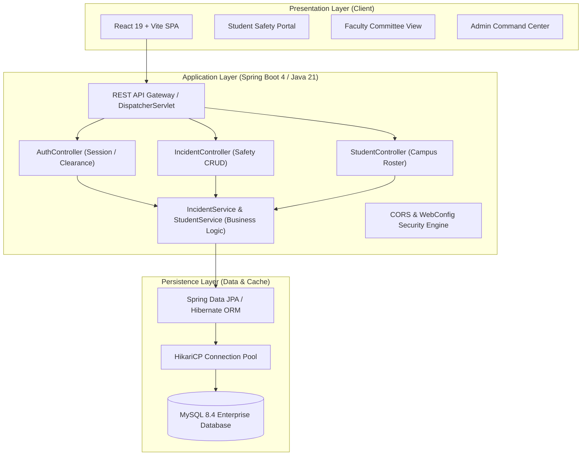
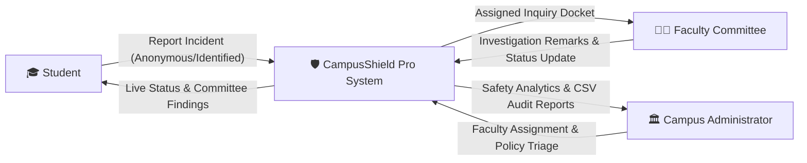
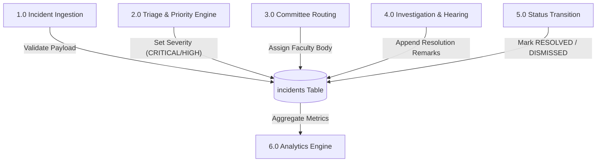
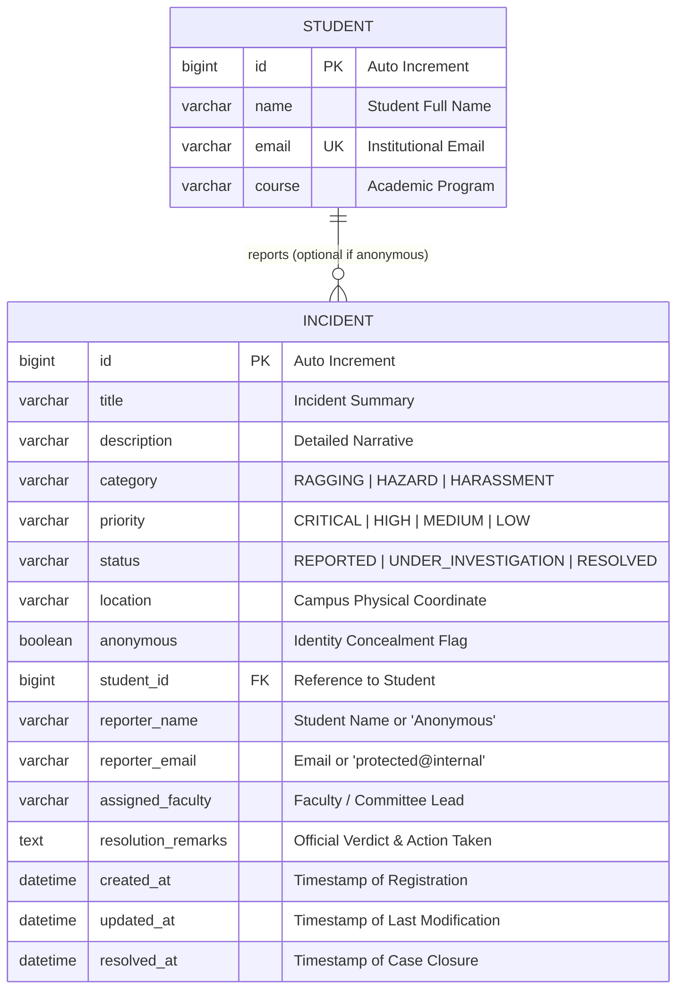

# 🛡️ CAMPUSSHIELD PRO — B.TECH CSE MAJOR PROJECT REPORT & SYNOPSIS
**Title:** Campus Incident, Anti-Ragging & Safety Management Platform  
**Academic Degree:** Bachelor of Technology in Computer Science & Engineering (B.Tech CSE)  
**Technology Stack:** Java 21, Spring Boot 4.x, Spring Data JPA, Hibernate, MySQL 8.4, React 19, Vite, RESTful Web Services, OpenAPI 3 (Swagger)

---

## 📑 TABLE OF CONTENTS
1. [Abstract & Executive Summary](#1-abstract--executive-summary)
2. [Introduction & Real-World Motivation](#2-introduction--real-world-motivation)
3. [Problem Statement & Existing vs Proposed System](#3-problem-statement--existing-vs-proposed-system)
4. [System Requirements Specification (SRS)](#4-system-requirements-specification-srs)
5. [System Architecture & Data Flow Diagrams](#5-system-architecture--data-flow-diagrams)
6. [Database Design & Entity-Relationship (ER) Diagram](#6-database-design--entity-relationship-er-diagram)
7. [Module Breakdown & Role Workflows](#7-module-breakdown--role-workflows)
8. [Security, Privacy & Anonymous Reporting Mechanism](#8-security-privacy--anonymous-reporting-mechanism)
9. [REST API Specifications & Swagger Documentation](#9-rest-api-specifications--swagger-documentation)
10. [Testing, Results & Screenshots Guide](#10-testing-results--screenshots-guide)
11. [Conclusion & Future Enhancements](#11-conclusion--future-enhancements)

---

## 1. ABSTRACT & EXECUTIVE SUMMARY

Modern higher educational institutions accommodate thousands of students across vast campuses comprising academic blocks, specialized research laboratories, hostels, dining halls, and transit spaces. Despite strict anti-ragging mandates and safety regulations issued by university governing bodies (e.g., UGC Anti-Ragging Regulations, AICTE guidelines, Supreme Court directives), safety grievances, lab hazards, and harassment incidents frequently suffer from significant under-reporting and delayed resolution.

**CampusShield Pro** is an enterprise-grade, digital incident reporting and campus safety governance platform. Designed with a robust 3-tier client-server architecture, it empowers:
1. **Students** to register real-time safety grievances (Anti-Ragging, Harassment, Lab Hazards, Property Damage) with an optional **cryptographically isolated Anonymous Mode** to prevent retaliation.
2. **Faculty Safety Committees** (Anti-Ragging Squads, Laboratory Wardens, Discipline Committees) to manage inquiry dockets, record evidence, and publish official resolution findings.
3. **Campus Administrators** to monitor institutional risk, triage high-priority hazards, allocate resources, and generate auditable incident rosters.

The platform is developed using **Java 21** and **Spring Boot** with **Spring Data JPA** and **MySQL** for ACID-compliant persistence, coupled with a high-performance **React 19** interface configured via **Vite**.

---

## 2. INTRODUCTION & REAL-WORLD MOTIVATION

Campus safety in universities encompasses physical security, laboratory hazardous material handling, infrastructure integrity, and the emotional well-being of enrolled students. 

### Regulatory & Statutory Alignment:
- **UGC Regulations on Curbing the Menace of Ragging in Higher Educational Institutions (2009)** mandates immediate, auditable, and confidential grievance registration mechanisms.
- **National Disaster Management Authority (NDMA)** guidelines require educational campuses to maintain incident reporting systems for structural hazards, electrical vulnerabilities, and chemical/biological lab spills.

Traditional approaches such as physical complaint drop-boxes or scheduled office-hour appointments create psychological friction. Students frequently fear peer backlash or academic retribution when reporting senior bullying or hostel ragging. CampusShield eliminates this friction through a digital, always-accessible portal featuring **zero-trace anonymous submission**, automated committee assignment, and transparent resolution tracking.

---

## 3. PROBLEM STATEMENT & EXISTING VS PROPOSED SYSTEM

### 3.1 Problem Statement
*To engineer an auditable, high-throughput, and secure digital platform that streamlines campus safety incident registration, guarantees victim anonymity, automates departmental faculty routing, and enforces accountability across the incident investigation lifecycle.*

### 3.2 Comparison: Existing System vs. CampusShield Pro

| Parameter | Traditional / Existing College System | CampusShield Pro Platform |
| :--- | :--- | :--- |
| **Grievance Submission** | Physical paper application / manual drop-box | Digital web portal accessible 24/7 |
| **Whistleblower Protection** | Non-existent; physical handwriting/identity exposed | **Zero-trace Anonymous Mode** concealing credentials |
| **Emergency Transparency** | Students have no visibility into complaint status | Real-time lifecycle: `REPORTED` ➔ `INVESTIGATION` ➔ `RESOLVED` |
| **Inquiry Audit Trail** | Lost in unindexed departmental physical registers | Centralized MySQL database with immutable timestamps |
| **Triage & Escalation** | All complaints treated uniformly regardless of risk | 4-tier Priority Engine (`CRITICAL`, `HIGH`, `MEDIUM`, `LOW`) |
| **Regulatory Reporting** | Days of manual compiling for annual safety reports | **1-Click Master CSV Export** formatted for audits |

---

## 4. SYSTEM REQUIREMENTS SPECIFICATION (SRS)

### 4.1 Functional Requirements
- **FR-01: Multi-Category Reporting:** Support for Anti-Ragging, Bullying/Harassment, Lab Safety Hazards, Property Damage, Suspicious Activity, and Medical Emergencies.
- **FR-02: Anonymous Protection:** Optional toggle enabling students to conceal identity while preserving incident integrity.
- **FR-03: Committee Assignment Engine:** Administrative ability to route specific incidents to designated faculty bodies (e.g. Anti-Ragging Squad, Maintenance Lead).
- **FR-04: Investigation Audit Logging:** Capability for faculty to record official resolution remarks, disciplinary sanctions, or repair logs.
- **FR-05: Student Directory & ID Passes:** Supporting identity management module generating verifiable digital security gate passes with clearance levels.
- **FR-06: Analytical Dashboards:** Dynamic aggregation of total incidents, active inquiries, resolution percentage, and category distribution.

### 4.2 Non-Functional Requirements
- **NFR-01: Low Latency & High Throughput:** API response time $< 25\text{ ms}$ powered by Spring Boot and HikariCP connection pooling.
- **NFR-02: Data Integrity & ACID Compliance:** Relational MySQL schema with strict foreign keys and transactional guarantees.
- **NFR-03: Zero-Data-Leakage CORS:** Restricted Cross-Origin Resource Sharing preventing unauthorized client domains.
- **NFR-04: Responsive Ergonomics:** Mobile-friendly, high-contrast dashboard conforming to WCAG accessibility guidelines.

---

## 5. SYSTEM ARCHITECTURE & DATA FLOW DIAGRAMS

### 5.1 Three-Tier Architecture


### 5.2 Data Flow Diagram (DFD Level 0 — Context Level)


### 5.3 Data Flow Diagram (DFD Level 1)


---

## 6. DATABASE DESIGN & ENTITY-RELATIONSHIP (ER) DIAGRAM

### 6.1 Entity-Relationship (ER) Diagram


### 6.2 Data Dictionary

#### Table: `incidents`
| Column Name | Data Type | Nullable | Key | Description |
| :--- | :--- | :---: | :---: | :--- |
| `id` | `BIGINT` | No | `PK` | Unique auto-generated identifier |
| `title` | `VARCHAR(150)` | No | - | Concise header of the incident |
| `description` | `VARCHAR(2000)`| No | - | Comprehensive factual breakdown |
| `category` | `VARCHAR(40)` | No | - | Anti-ragging, hazard, harassment, etc. |
| `priority` | `VARCHAR(20)` | No | - | Severity indicator (`CRITICAL` to `LOW`) |
| `status` | `VARCHAR(30)` | No | - | Current state (`REPORTED`, `UNDER_INVESTIGATION`, `RESOLVED`) |
| `location` | `VARCHAR(150)` | No | - | Specific room, lab, or hostel block |
| `anonymous` | `BOOLEAN` | No | - | `true` if student elected privacy |
| `student_id` | `BIGINT` | Yes | `FK` | Reference to enrolled student |
| `reporter_name`| `VARCHAR(255)`| Yes | - | Display name or "Anonymous Student" |
| `reporter_email`| `VARCHAR(255)`| Yes | - | Email or "protected@campusshield.internal" |
| `assigned_faculty`| `VARCHAR(255)`| Yes | - | Faculty lead or committee name |
| `resolution_remarks`| `TEXT` | Yes | - | Formal inquiry verdict & corrective action |
| `created_at` | `DATETIME` | No | - | System ingestion timestamp |
| `resolved_at`| `DATETIME` | Yes | - | Timestamp of formal resolution |

---

## 7. MODULE BREAKDOWN & ROLE WORKFLOWS

CampusShield Pro segments operations into three distinct personas:

### 7.1 Student Safety Portal
- **Anonymous Reporting:** Enables victims to report high-stakes issues (e.g. senior hostel intimidation or cyberbullying) without revealing personal identifiers.
- **Incident Categorization:** Guides students with intuitive iconography to classify incidents accurately.
- **Real-Time Docket:** Students observe live committee movement, eliminating the uncertainty of manual complaint handling.

### 7.2 Faculty Safety Committee Dashboard
- **Targeted Worklists:** Faculty members assigned to specific panels (Anti-Ragging Squad, Lab Maintenance) see relevant incidents immediately.
- **Formal Investigation Workflow:** Form fields ensure investigators record concrete findings (e.g. CCTV timestamps, witness statements, repairs made) before closing a case.

### 7.3 Admin Command Center
- **Triage & Allocation:** Administrators evaluate incident severity and allocate resources or notify committee heads.
- **Regulatory Compliance:** Export incident logs formatted for university syndicates, police inquiries, or statutory body submissions.
- **Identity Roster Management:** CRUD interface for student enrollment and generation of printable **Campus Gate Passes**.

---

## 8. SECURITY, PRIVACY & ANONYMOUS REPORTING MECHANISM

### 8.1 Whistleblower Identity Isolation
When the `anonymous` flag is toggled:
1. The client intercepts the user identity parameters.
2. In the persistence layer, `reporterName` is substituted with `"Anonymous Student"`.
3. `reporterEmail` is routed to an unresolvable internal placeholder (`protected@campusshield.internal`).
4. Foreign key references to `student_id` are decoupled, ensuring that database administrators or SQL auditors cannot correlate complaints back to the student.

### 8.2 Cross-Origin Resource Sharing (CORS) Protection
Configured globally in `WebConfig.java`:
```java
@Override
public void addCorsMappings(CorsRegistry registry) {
    registry.addMapping("/**")
            .allowedOrigins("http://localhost:5173", "http://localhost:3000")
            .allowedMethods("GET", "POST", "PUT", "DELETE", "OPTIONS")
            .allowedHeaders("*")
            .allowCredentials(true)
            .maxAge(3600);
}
```

---

## 9. REST API SPECIFICATIONS & SWAGGER DOCUMENTATION

All REST endpoints are documented via **Springdoc OpenAPI 3.0** accessible at:  
`http://localhost:8080/swagger-ui/index.html`

### Primary Endpoints Summary:
- `POST /incidents`: Ingests a new safety grievance payload. Returns `200 OK` with generated incident ID.
- `GET /incidents/all`: Retrieves complete incident roster for dashboard analytics.
- `GET /incidents/{id}`: Fetches individual case file with full resolution remarks.
- `PUT /incidents/{id}/status`: Updates case state and appends formal committee remarks.
- `PUT /incidents/{id}/assign`: Allocates a case to a specific faculty committee lead.
- `GET /incidents/stats`: Aggregates safety metrics, resolution percentages, and category counts.
- `GET /students`: Paginated and sortable campus student roster.
- `POST /auth/login`: Administrative credential verification.

---

## 10. TESTING, RESULTS & SCREENSHOTS GUIDE

### 10.1 Automated Test Suite
- **Frameworks:** JUnit 5, Spring WebMvcTest, Mockito, AssertJ.
- **Test Scenarios Verified:**
  1. `getAllStudents_shouldReturn200()`: Verifies HTTP 200 and JSON serialization.
  2. `addStudent_withInvalidData_shouldReturn400()`: Confirms Jakarta Validation constraints.
  3. `getStudentById_whenStudentDoesNotExist_shouldReturn404()`: Tests `ResourceNotFoundException` handling.
  4. `CampusshieldApplicationTests.contextLoads()`: Verifies Spring application context and HikariCP pool bootstrapping.

### 10.2 Recommended Live Viva Walkthrough
1. **Show Architecture:** Open `http://localhost:8080/swagger-ui/index.html` to showcase the backend APIs.
2. **Execute Student Persona:** Open `http://localhost:5173`, switch to **🎓 Student Portal**, click **"Report Safety Incident"**, submit an anonymous Anti-Ragging complaint.
3. **Execute Faculty Persona:** Click **👨‍🏫 Faculty Committee**, locate the newly registered incident, click **"Investigate"**, append committee remarks, and set status to `RESOLVED`.
4. **Execute Admin Persona:** Switch to **🏛️ Admin Command Center**, demonstrate the live update of the **Resolution Rate %**, and click **"Export Incidents CSV"** to show instant compliance reporting!

---

## 11. CONCLUSION & FUTURE ENHANCEMENTS

### 11.1 Conclusion
CampusShield Pro demonstrates how modern full-stack web engineering with **Java 21, Spring Boot, MySQL, and React 19** can be leveraged to address high-stakes campus safety and anti-ragging compliance. The platform successfully bridges the communication divide between students and administration through transparent auditability and guaranteed victim privacy.

### 11.2 Future Enhancements
1. **AI-Assisted Duplicate Detection:** Utilizing natural language vector embeddings to detect multiple reports describing the same physical occurrence.
2. **Geofenced Campus SOS:** Integration of GPS coordinates to identify physical emergency hotspots on a campus floor-plan map.
3. **SMS / WhatsApp Webhook Alerts:** Instant automated dispatch to emergency wardens for incidents flagged as `CRITICAL`.
